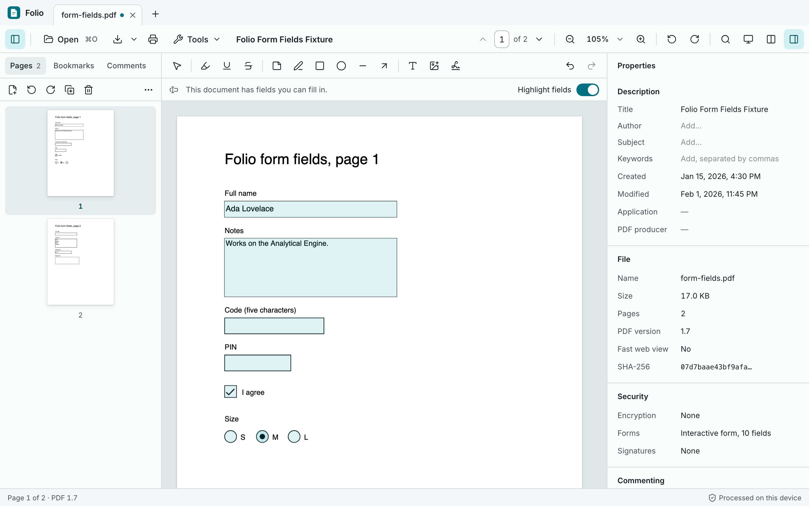
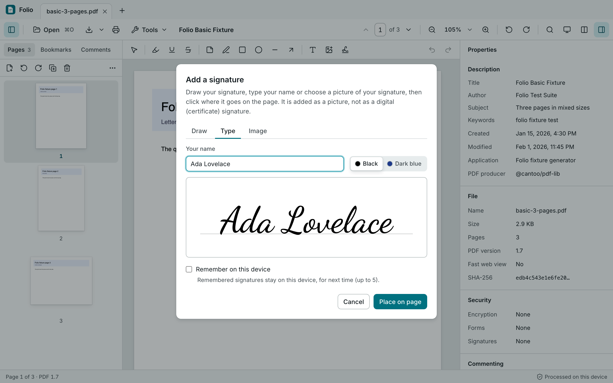
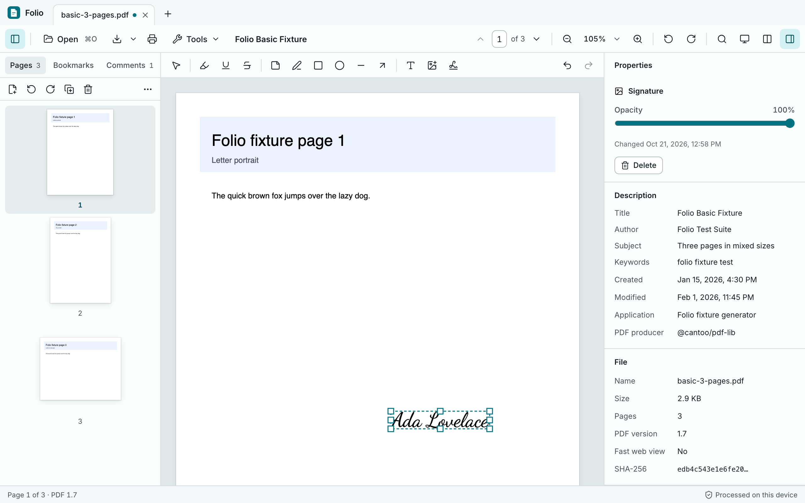
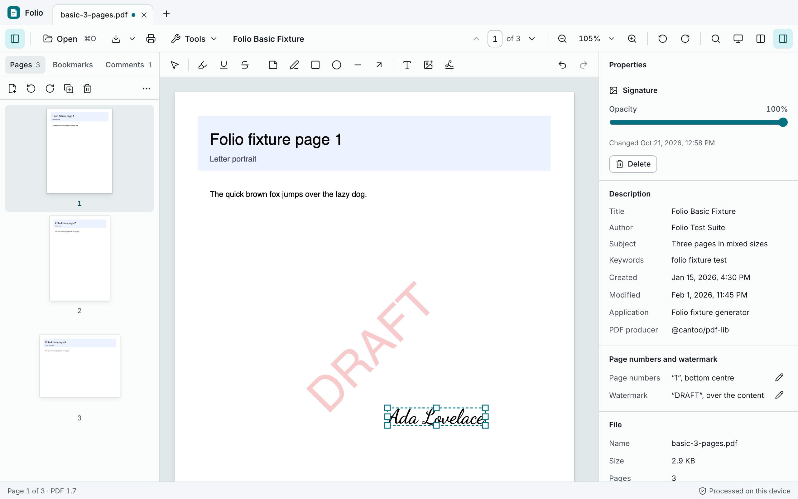
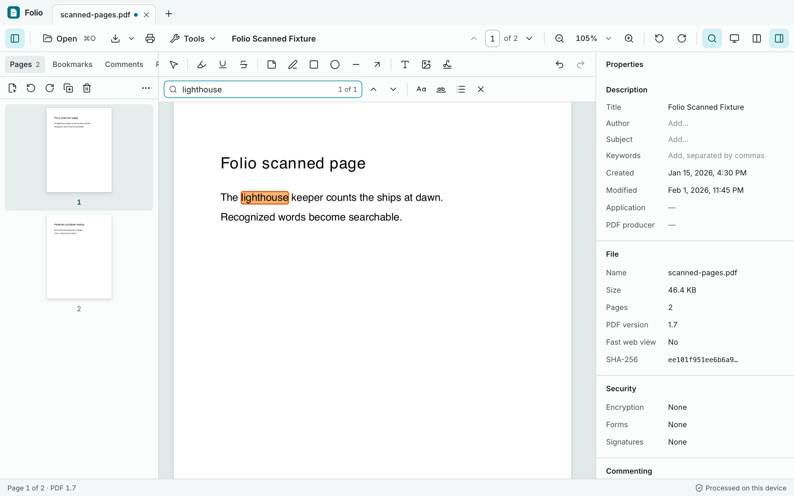
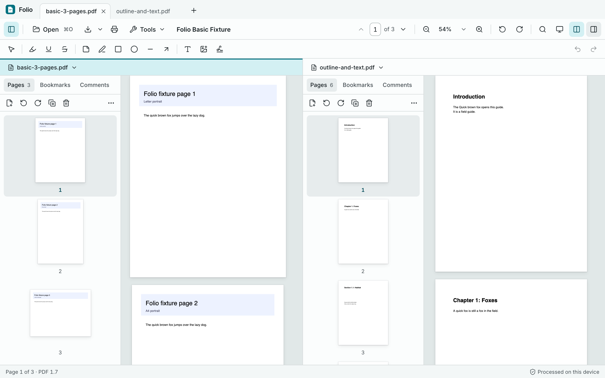
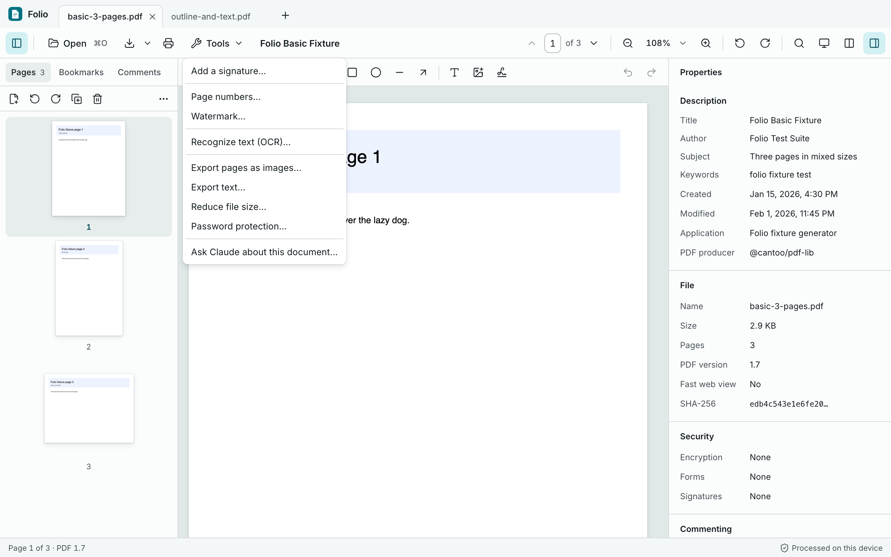
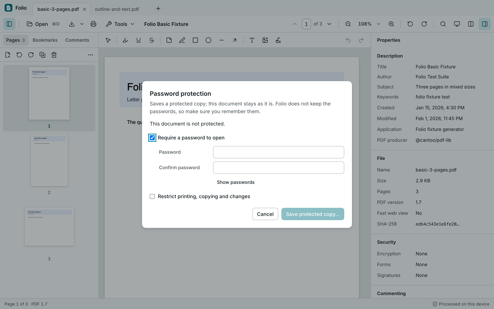
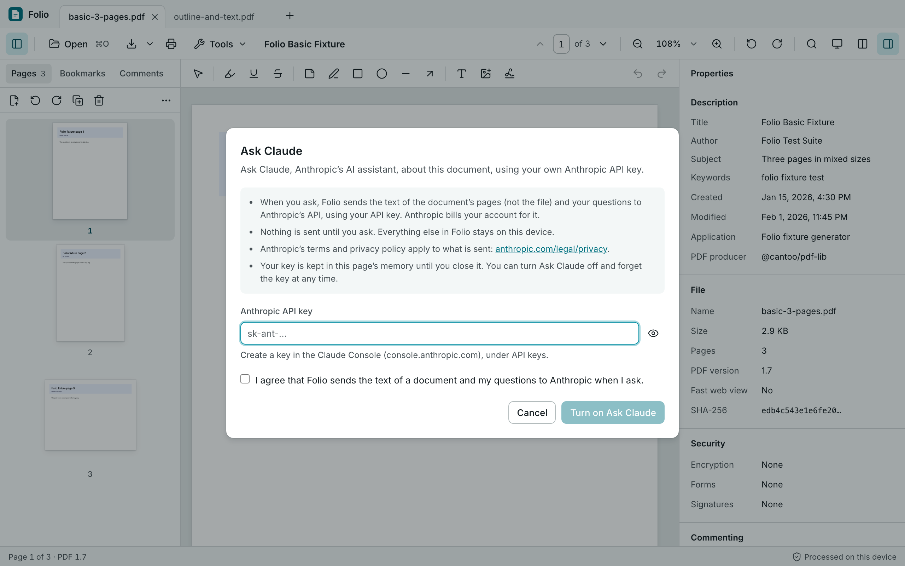

# Folio

[](https://github.com/albird97/folio/actions/workflows/ci.yml)
[](https://github.com/albird97/folio/actions/workflows/desktop.yml)

Folio is a local-first PDF suite for **macOS**, **Windows** and **Google Chrome**. It is one
product: the document model, PDF engine, design system and workspace UI are shared, and each
target adds a thin platform adapter.

> **Status: Phase 6 (Advanced tools) complete; Phase 7 (Release quality) under way.** Folio opens, reads, edits, saves and prints
> PDFs on all three targets, and the Chrome extension and the desktop app work together:
>
> - **Opening:** file picker, drag and drop, recent files, launch arguments and Finder events on
>   desktop (one running app), and in Chrome: a web address, the PDF in the current tab, the PDFs
>   a page links to, and a side-panel hand-off. Password-protected files can be unlocked.
> - **Viewing:** a continuous, virtualized page viewer that stays fast with thousands of pages:
>   thumbnails, bookmarks, page navigation, zoom (fit width, fit page, presets, Ctrl+wheel and
>   pinch), view rotation, text selection and copying, and whole-document search with highlights.
>   Scanned pages become searchable with on-device OCR (English, Indonesian, Chinese).
> - **Editing:** highlight, underline and strike through text, notes, freehand drawing, shapes,
>   added text and images, with a Comments list and an inspector; copy, cut and paste of comments
>   and pasting images. Pages can be reordered, rotated, duplicated, deleted, inserted, extracted
>   and split. Document properties are editable. Forms are filled in on the page; signatures are
>   drawn, typed or imported and placed; page numbers and watermarks are added. Everything is
>   undoable.
> - **Saving:** **Save** writes changes back to the opened file on desktop (atomically, and never
>   over a file another program changed without asking); **Save as** writes a new file (a save
>   dialog on desktop, a download in Chrome) with comments editable or flattened. Folio never
>   overwrites the files you open on its own.
> - **Printing** of all, current or chosen pages, with or without comments.
> - **Tools:** export pages as images or text, reduce file size, save copies with or without a
>   password, and, if you turn it on with your own Anthropic API key, ask Claude about a document.
> - **Updates:** the desktop app can check for signed updates, only if you ask it to.
> - **Crash recovery:** unsaved changes are kept on the device and offered again after a crash.
> - **Chrome tools:** the side panel rotates and extracts pages, turns pages into images and
>   extracts text; the popup saves the current page as PDF through Chrome's print dialog; any
>   document can be handed to the desktop app (native messaging), which asks before opening it.
> - The native integrations (dialogs, Save, printing, menus, recent files, recovery, single
>   instance, native messaging) are built in CI and tested on Linux, **partly verified on a real
>   Mac** and **not yet verified on a real Windows PC**.
>
> See [IMPLEMENTATION_PLAN.md](IMPLEMENTATION_PLAN.md) for the roadmap and
> [PLATFORM_CAPABILITIES.md](PLATFORM_CAPABILITIES.md) for the support matrix.

Documents are processed on your device and never uploaded, unless you turn on **Ask Claude** and
ask a question (then the text of the chosen pages goes to Anthropic with your own API key). The
desktop app makes no other network requests, except checking for updates when you choose **Check
for Updates…** or turn on automatic checks; the extension downloads a PDF only from a site you
allow, when you ask it to.

## Download

The newest release of the desktop app, for anyone who has access to this repository:

| System  | Installer                                                                                                                   |
| ------- | --------------------------------------------------------------------------------------------------------------------------- |
| macOS   | [**Folio-macOS.dmg**](https://github.com/albird97/folio/releases/latest/download/Folio-macOS.dmg) (Intel and Apple silicon) |
| Windows | [**Folio-Windows-setup.exe**](https://github.com/albird97/folio/releases/latest/download/Folio-Windows-setup.exe) (64-bit)  |

All files of every release, including the Chrome extension zip, are on the
[Releases page](https://github.com/albird97/folio/releases).

- The repository is private: sign in to GitHub with an account that has access, or the links
  show "404".
- The installers are not code-signed yet, so the system warns the first time:
  - **macOS:** open the DMG and drag Folio to Applications. The first time, right-click Folio
    and choose **Open**, then **Open** again (or **System Settings → Privacy & Security → Open
    Anyway**).
  - **Windows:** run the setup. If SmartScreen says "Windows protected your PC", click **More
    info → Run anyway**. Folio installs for the current user only; no administrator rights are
    needed.

## Features

The screenshots show the desktop app; the Chrome extension's editor looks and works the same.

### Read, search and annotate

Open one or more PDFs as tabs. The page list on the left shows thumbnails, bookmarks and
comments; the Properties panel on the right shows the document's details. Highlight, underline or
strike through text, add notes, draw, add shapes, text and pictures from the toolbar, and undo any
change.

### Fill in forms

Forms are filled in right on the page: text fields, check boxes, radio buttons and lists. **Save**
keeps the values in the PDF, so other PDF apps see them too.



### Sign

**Tools → Add a signature…**: draw your signature, type your name or choose a picture of it, then
click where it goes. Move and resize it like any other item. Folio can remember up to five
signatures on your device. (It is a picture of a signature, not a digital certificate.)

<p>
  
  
</p>

### Page numbers and watermarks

**Tools → Page numbers…** and **Tools → Watermark…** add page numbers or a text watermark such as
"DRAFT" to every page (or a range). Change or remove them later in the Properties panel.



### Make scanned pages searchable (OCR)

**Tools → Recognize text (OCR)…** reads the text on scanned pages, on your device (English,
Indonesian and Chinese). Then you can search, select and copy that text, and it is saved with the
document.



### Two documents side by side

The **split view** button in the toolbar shows two documents next to each other, each with its own
page list. Select pages on one side and drag them into the other document's page list to **copy**
them there (the original stays as it is), like in Preview on a Mac. Without dragging: the page
list's **⋯ → Copy pages to …**.



### Tools

The **Tools** menu has everything beyond reading and annotating: signatures, page numbers,
watermarks, OCR, exporting pages as images (PNG or JPEG) or the text (TXT), reducing the file
size, password protection and Ask Claude. The page list's buttons insert, rotate, duplicate,
delete, extract and split pages.



### Password protection

**Tools → Password protection…** saves a protected copy: require a password to open it, and/or
restrict printing, copying and changes. The open document stays as it is, and Folio does not keep
the passwords.



### Ask Claude (optional)

**Tools → Ask Claude about this document…** lets you ask questions about the document, summarize
it or find things in it, with your own Anthropic API key. It is off until you turn it on, and
nothing is sent until you ask; then only the text of the pages and your question go to
Anthropic.



The screenshots are taken from test documents by `node docs/screenshots/take.mjs` (after
`pnpm build:desktop:web`).

## Repository layout

| Path                         | What it is                                                                        |
| ---------------------------- | --------------------------------------------------------------------------------- |
| `apps/desktop`               | Tauri 2 app: React UI (`src/`), Rust commands, menus and packaging (`src-tauri/`) |
| `apps/chrome-extension`      | Manifest V3 extension: popup, side panel, editor page, options, service worker    |
| `packages/document-model`    | Document types, IDs, operations, undo/redo history, recovery snapshots            |
| `packages/pdf-core`          | PDF.js engine wrapper: loading, rendering, text, outlines, bundled PDF.js assets  |
| `packages/platform-adapters` | Platform adapter contract, web/memory adapters, capability matrix                 |
| `packages/shared-ui`         | Design tokens, Tailwind theme, accessible primitives, brand mark                  |
| `packages/editor`            | The shared workspace: tabs, toolbar, viewer, sidebar, search, and its stores      |
| `tests/`                     | PDF fixtures, Playwright suites, the native desktop WebDriver test                |
| `brand/`                     | Original Folio artwork (SVG sources and the 1024px app icon)                      |

## Prerequisites

- **Node.js 22.13+** and **pnpm 10** (`corepack enable` picks up the pinned version).
- **Rust** (stable) for the desktop app.
- **Platform toolchains for Tauri:**
  - macOS: Xcode Command Line Tools.
  - Windows: Microsoft C++ Build Tools and WebView2 (preinstalled on Windows 10/11).
  - Linux: `libwebkit2gtk-4.1-dev`, `build-essential`, `libxdo-dev`, `libssl-dev`,
    `libayatana-appindicator3-dev` and `librsvg2-dev`.
- Optional: `qpdf` (to regenerate fixtures) and `tauri-driver` + `webkit2gtk-driver` (native e2e on Linux).

```sh
pnpm install
```

## Commands

| Task                                                 | Command                                                                                         |
| ---------------------------------------------------- | ----------------------------------------------------------------------------------------------- |
| Desktop app, development (native window, hot reload) | `pnpm dev:desktop`                                                                              |
| Desktop UI in a normal browser (web adapter)         | `pnpm dev:desktop:web` → http://localhost:1420                                                  |
| Build macOS app + DMG (universal, on macOS)          | `pnpm build:desktop:macos`                                                                      |
| Build Windows MSI + NSIS installer (on Windows)      | `pnpm build:desktop:windows`                                                                    |
| Build Linux .deb (on Linux)                          | `pnpm build:desktop:linux`                                                                      |
| Build for the current platform, all bundle types     | `pnpm build:desktop`                                                                            |
| Extension, development (rebuilds on change)          | `pnpm dev:extension`                                                                            |
| Extension, production build                          | `pnpm build:extension` → `apps/chrome-extension/dist`                                           |
| Extension, Web Store zip                             | `pnpm --filter @folio/chrome-extension package`                                                 |
| Unit tests (all packages and apps)                   | `pnpm test`                                                                                     |
| E2E: extension + desktop UI (build both first)       | `pnpm build:extension && pnpm build:desktop:web && pnpm test:e2e`                               |
| E2E: real desktop binary (verified on Linux)         | `pnpm build:desktop:linux && xvfb-run -a pnpm test:e2e:desktop`                                 |
| E2E: extension → desktop host (native messaging)     | `cargo build -p folio-desktop && pnpm exec playwright test tests/e2e/extension/desktop.spec.ts` |
| Rust tests / lint                                    | `pnpm test:rust` / `pnpm lint:rust`                                                             |
| Type checking, lint, formatting                      | `pnpm typecheck`, `pnpm lint`, `pnpm format:check`                                              |
| Everything quick (format, lint, types, unit)         | `pnpm check`                                                                                    |
| Regenerate PLATFORM_CAPABILITIES.md                  | `pnpm capabilities:generate`                                                                    |
| Regenerate PDF fixtures (needs qpdf)                 | `pnpm fixtures:generate`                                                                        |

Release builds bundle the web UI and need neither Node.js nor Rust on the user's machine.
Installers appear under `target/release/bundle/` (or `target/universal-apple-darwin/release/bundle/` on macOS).

## Running the desktop app

1. `pnpm dev:desktop` starts Vite on port 1420 and opens Folio in a native window.
2. Open PDFs with **File → Open…** (⌘O / Ctrl+O), **File → Open Recent**, the recent files on
   the start screen, by dropping them onto the window, or by passing them on the command line
   (`target/release/folio-desktop file.pdf`). Opening a file while Folio runs hands it to the
   running window. Nothing is dropped silently: files that are not PDFs are reported, and a file
   that was moved or deleted before Folio could open it gets an error tab.
3. Scroll through the pages, or use the sidebar (thumbnails, bookmarks and search results), the
   page number field and the zoom menu in the toolbar.
4. **Save** (⌘S / Ctrl+S) writes your changes back to the file; **Print** (⌘P / Ctrl+P) asks
   which pages and whether to include comments, then opens the system print dialog. Closing the
   window with unsaved changes asks first. The window's size and position are remembered.

**Shortcuts:**

| Action                   | macOS               | Windows / Linux                       |
| ------------------------ | ------------------- | ------------------------------------- |
| Open                     | ⌘O                  | Ctrl+O                                |
| Save                     | ⌘S                  | Ctrl+S                                |
| Save as                  | ⇧⌘S                 | Ctrl+Shift+S                          |
| Save a copy of original  | ⌥⌘S                 | Ctrl+Alt+S                            |
| Print                    | ⌘P                  | Ctrl+P                                |
| Copy / cut / paste       | ⌘C / ⌘X / ⌘V        | Ctrl+C / Ctrl+X / Ctrl+V              |
| Undo / redo              | ⌘Z / ⇧⌘Z            | Ctrl+Z / Ctrl+Shift+Z or Ctrl+Y       |
| Close document           | ⌘W                  | Ctrl+W                                |
| Close window             | ⇧⌘W                 | —                                     |
| Next / previous document | ⌃Tab / ⌃⇧Tab        | Ctrl+Tab / Ctrl+Shift+Tab             |
| Sidebar                  | ⌘⌥1                 | Ctrl+Alt+1                            |
| Properties panel         | ⌘⌥2                 | Ctrl+Alt+2                            |
| Split view               | ⌘⌥3                 | Ctrl+Alt+3                            |
| Zoom in / out            | ⌘= / ⌘-             | Ctrl+= / Ctrl+-                       |
| Actual size              | ⌘0                  | Ctrl+0                                |
| Rotate view right / left | ⌘R / ⌘L             | Ctrl+R / Ctrl+L                       |
| Go to page               | ⌘⌥G                 | Ctrl+Alt+G                            |
| Find                     | ⌘F                  | Ctrl+F                                |
| Find next / previous     | ⌘G / ⇧⌘G (F3 / ⇧F3) | Ctrl+G / Ctrl+Shift+G (F3 / Shift+F3) |

Single keys pick a drawing tool while the pages have focus: V Select, H Highlight, U Underline,
K Strikethrough, N Note, P Draw, R Rectangle, O Ellipse, L Line, A Arrow, T Add text, I Add image,
S Sign.

In the page view, arrow keys, Page Up/Down and Space scroll, ← and → turn pages when the page
fits the window's width, and Home/End go to the first and last page. Ctrl+wheel and trackpad or
touch pinches zoom around the pointer. Fit width and Fit page are in
the zoom menu and the **View** menu. Rotation only changes the view; the file is not modified.

The macOS menus are Folio, File, Edit, View, Pages, Tools and Window. ⌘W closes the current document, so
**Window → Close Window** uses ⇧⌘W. Windows and Linux have File, Edit, View, Pages, Tools and
Help (**Help → About Folio**). **Check for Updates…** and **Check for Updates Automatically** (off
by default; at most once a day) are in the Folio menu on macOS and the Help menu elsewhere; updates
must be signed with Folio's key, and unsaved work is asked about before Folio restarts. Switching the theme has no shortcut: use the toolbar button or
**View → Switch Theme**. Letter shortcuts follow your keyboard layout (AZERTY included), and
AltGr combinations never trigger shortcuts.

### Editing

- **Comments and drawing:** the tool bar above the pages has Select, Highlight, Underline,
  Strikethrough, Note, Draw, Rectangle, Ellipse, Line, Arrow, Add text and Add image. The markup
  tools mark the text you select. With Select, click an annotation to select it, drag it to
  move it, drag its handles to resize it, use the arrow keys to nudge it (Shift for 10 pt) and
  Delete to remove it; double-click a note or a text box to edit it. The Properties panel shows
  the selected annotation's colour, opacity, line width, font and text. The **Comments** tab in
  the sidebar lists every annotation.
- **Added text is new content** placed on top of the page in a standard PDF font (Helvetica,
  Times or Courier). Folio does not edit the PDF's existing text. Characters these fonts cannot
  show are saved as "?", and Folio says so.
- **Pages:** select pages in the Pages tab (Shift-click for a range, Ctrl/⌘-click to add), drag
  them to reorder, and use the buttons above the thumbnails to insert a blank page or pages of
  another PDF, rotate, duplicate, delete, extract or split. In browsers, PDFs dropped between
  thumbnails are inserted there.
- **Properties:** title, author, subject and keywords are editable in the Properties panel.
- Folio follows the document's permission settings (for example, a PDF that does not allow
  comments), and saved copies of password-protected PDFs keep the same password and permissions.
- **Forms:** fields of a PDF form are filled in on the page with the Select tool: text, check
  boxes, radio buttons, drop-down and list boxes; a signature field offers to sign it. **Highlight
  fields** in the bar above the pages turns their tint off. Saving keeps the values as the form's
  own; **Save with form flattened** draws them into the pages. Password fields are never saved.
  XFA forms are shown as saved but cannot be filled in.
- **Signatures:** **Sign** (S, or Tools → Add a signature…) draws your signature with a mouse,
  trackpad, pen or finger, types your name in a handwriting font, or uses a picture of your
  signature with its paper made transparent. Click where it goes (Enter puts it in the middle of
  the page, Esc cancels), then move or resize it like an image. This adds a picture of a
  signature, not a digital (certificate) signature. **Remember on this device** (off by default)
  keeps up to five for next time, on this device only.
- **Page numbers and watermarks:** **Tools → Page numbers…** adds numbers such as “Page 1 of 12”
  (or your own text with {page} and {total}) at the top or bottom of the pages; **Tools →
  Watermark…** adds text across the pages at an angle and opacity, over or under their content.
  Both apply to all pages or a range, show at once, can be undone, and are drawn into the pages
  when you save or print, as new text in the standard PDF fonts. The Properties panel lists them.
- **Two documents side by side:** **View → Split View** (⌘⌥3 / Ctrl+Alt+3) shows two open
  documents next to each other. Drag pages (select several with Shift or ⌘/Ctrl) from one
  document's pages panel onto the other's to copy them there, like Preview; the original stays
  as it was. The pages menu's **Copy pages to…** does the same without dragging.
- **Clipboard:** with the pages focused, ⌘C/⌘X/⌘V (Ctrl+C/X/V) copy, cut and paste the selected
  comments, also into another open document; an image on the clipboard is pasted as an added
  image. Selected page text is copied as usual.

Folio never overwrites the files you open on its own. **Save** (⌘S / Ctrl+S) writes your changes
back to the file you opened (or last saved as) when you choose it: through a temporary file and an
atomic replace, so an interrupted save never leaves a half-written file. If another program
changed the file since Folio read it, Folio asks whether to replace it or save elsewhere; files
that cannot be written (read-only, moved) fall back to **Save as**. If the operating system lets
Folio move the old version aside but not put the new one in place, Folio puts the old version
back; should even that fail, it keeps the old version next to the file and says where. Folio's
own leftovers in a folder (`.folio-<id>.tmp` from an interrupted save, and on Windows a previous
version that could not be deleted right away, for example while antivirus software scanned it)
are deleted by a later save into that folder once they are an hour old. **Save as** (⇧⌘S /
Ctrl+Shift+S) writes the edited document to a new file you choose, and later saves go there; its
menu also offers a copy with comments flattened into the pages, and **Save a copy of the
original**, which writes the opened file unchanged. The Rust layer accepts only PDF data. The
webview never sees paths: files are reachable only through tokens issued by the Rust layer. Closing
a document or the window with unsaved changes asks first.

### Tools

The **Tools** menu (a native menu on desktop, a toolbar menu everywhere) works on the open
document; tools that write files save copies and never change the open document.

- **Recognize text (OCR)…** reads scanned pages on this device (English, Indonesian, Chinese
  Simplified and Traditional; nothing is downloaded). The text can then be searched, selected,
  copied and highlighted, and is saved into the PDF as invisible text. Undo removes it.
- **Export pages as images…** (PNG or JPEG at 72, 150 or 300 dpi; several pages as a ZIP) and
  **Export text…** (including recognized text; copy or save as .txt).
- **Reduce file size…** saves a smaller copy: lossless, or with large images re-encoded as JPEG.
- **Password protection…** saves a copy with a password to open and/or restrictions on printing,
  copying and changes (AES-256), or without the password of a document you opened with it. Folio
  re-opens every protected copy to check it before saving it.
- **Ask Claude…** (optional, off by default): with your own Anthropic API key, summarize a
  document or ask about it; answers stream and cite the pages they come from. When you ask, Folio
  sends the text of the chosen pages (never the file) and your questions to Anthropic;
  Anthropic's terms and privacy policy apply. The desktop app keeps the key in the macOS Keychain
  or Windows Credential Manager, where the page cannot read it; the extension keeps it in its
  local storage (never synced). Turn it off and forget the key at any time.

### Crash recovery and Folio's data folder

Two seconds after each change, unsaved documents are written to Folio's data folder (the document
state, the original files and added images). If Folio closes without saving, it offers the
documents again when it starts: **Restore** or **Discard**. Saving, closing a document or
discarding it deletes its recovery data; nothing is kept for documents without unsaved changes.
Passwords are never stored, so protected documents ask for theirs again.

The data folder is `~/Library/Application Support/io.github.albird97.folio` on macOS,
`%LOCALAPPDATA%\io.github.albird97.folio` on Windows and `~/.local/share/io.github.albird97.folio`
on Linux. It holds recovery data, the recent files list, documents waiting to be accepted from
Chrome (deleted when declined or after 24 hours) and, on Windows, the Chrome registration. Folio
creates it so that only your user can open it, and never opens files inside it as documents
(documents from Chrome only open through their prompt). While Folio runs it holds a lock there,
so a second copy started by accident does not clean up anything the first one still uses.
`FOLIO_DATA_DIR` moves the folder, and in debug builds `FOLIO_NATIVE_HOST_NO_LAUNCH=1` keeps the
native messaging host from starting the app (both used by tests).

## Installing and testing the Chrome extension

1. `pnpm build:extension` (or `pnpm dev:extension` to rebuild on change).
2. Open `chrome://extensions`, enable **Developer mode** and choose **Load unpacked**.
3. Select `apps/chrome-extension/dist`. Chrome 116 or newer is required. The manifest carries a
   development key, so the extension always gets the ID `ghfckfnleaidabfhaplbnfknipajedan`
   (the one the desktop app accepts documents from).
4. Pin Folio and click its icon (or press Alt+Shift+F):
   - **Open a PDF** opens the editor tab: choose or drop files there, or use **Open from a web
     address…**.
   - **This tab**: **Open this PDF in Folio** (when the tab shows a PDF), **PDFs on this page**
     (opens the side panel with the PDFs the page links to, to open or download) and **Save page
     as PDF** (Chrome's print dialog; choose "Save as PDF").
   - **Open side panel**: inspect a PDF, hand it to the editor or the desktop app, and use its
     tools: rotate pages, extract pages, pages to PNG/JPEG (several as a ZIP) and extract text.
   - **Settings** (the gear): theme, activity privacy, permissions (with the sites Folio may read,
     each removable) and the desktop connection check.

In development, click the reload icon on `chrome://extensions` after each rebuild. Editor-page
shortcuts avoid keys Chrome reserves. Shortcuts without Ctrl/⌘ (Alt+W, Alt+PageDown/PageUp) are
ignored while you type in a field:

| Action                   | Shortcut                           |
| ------------------------ | ---------------------------------- |
| Open                     | Ctrl/⌘+O                           |
| Download PDF (edited)    | Ctrl/⌘+Shift+S                     |
| Download the original    | Ctrl/⌘+Alt+S                       |
| Print                    | Ctrl/⌘+P                           |
| Undo / redo              | Ctrl/⌘+Z / Ctrl/⌘+Shift+Z          |
| Close document           | Alt+W                              |
| Next / previous document | Alt+PageDown / Alt+PageUp          |
| Sidebar                  | Ctrl/⌘+Alt+1                       |
| Properties panel         | Ctrl/⌘+Alt+2                       |
| Split view               | Ctrl/⌘+Alt+3                       |
| Zoom in / out, actual    | Ctrl/⌘+= / Ctrl/⌘+- / Ctrl/⌘+0     |
| Go to page               | Ctrl/⌘+Alt+G                       |
| Find, next, previous     | Ctrl/⌘+F, Ctrl/⌘+G or F3, Shift+F3 |

Folio's find bar replaces Chrome's in the editor (Chrome's would only see the pages on screen).
Rotation uses the toolbar buttons: Chrome keeps Ctrl+R and Ctrl+L. Downloads go through Chrome's
downloads and need no extra permission. Unsaved changes in the editor are kept in the extension's
storage and offered again when the editor opens, unless another editor tab still has them open.

**Permissions.** At install the extension asks only for `storage`, `sidePanel`, `activeTab` and
`scripting`, none of which shows a warning; `activeTab` and `scripting` only apply to a tab after
you click Folio's toolbar button on it. Everything else is asked for when first used:

- **Site access** (`https://*/*`, `http://*/*` as optional host permissions): Chrome asks for one
  site at a time when you open a PDF from it. Downloads run in the service worker, without
  cookies or a referrer; if a site answers with a sign-in page, Folio asks before trying again
  with your browser's sign-in for that one request. The extension's pages cannot connect to any
  server (their CSP allows only the extension itself).
- **`downloads`**: to save PDFs linked from a page with Chrome's downloads.
- **`nativeMessaging`**: to hand documents to the desktop app.

Chrome does not let extensions read PDFs opened from your computer (`file://` tabs) or run
scripts on its own pages and the Web Store; Folio says so where that matters.

## Connecting Chrome and the desktop app

The extension hands documents to the desktop app through Chrome native messaging. The host is the
Folio desktop binary itself, registered as `io.github.albird97.folio`.

1. Install Folio for desktop (move it to Applications on macOS first), open it, choose
   **File → Connect to Chrome…** and select **Connect**. The dialog defaults to **Cancel**, and
   only the app's own menu can connect: the app's web page cannot.
2. In Chrome, use **Open in Folio for desktop** in the editor's save menu or in the side panel.
   Chrome asks once for the `nativeMessaging` permission.
3. Folio for desktop asks before it opens the document. Declined documents are deleted.

If the app is missing or not connected, the extension explains how to connect it, and
**Settings → Folio for desktop → Check connection** tests the link. **Connect to Chrome…** refuses
to register a copy of Folio that others could replace or that may go away, and says why: one
running from the temporary folder, a removable drive, disk image or RAM disk, a network share
(Windows), or (on macOS) a translocated download; on macOS and Linux also one where the program
or a folder above it belongs to another user (only root and you count) or can be changed by
others (writable by everyone, or by its group unless root owns the folder, like `/Applications`,
or the group is your own private group; a sticky folder like `/tmp` is fine further up, but not
as the program's own folder); on Windows also one where the program or a folder above it lets
Everyone, Users or Authenticated Users write to it (as in a folder created directly on `C:\`).
Move Folio to Applications (macOS), Program Files or your own user folder (Windows), or a folder
only you can change (Linux), then try again. The registration names the program's real path,
with links resolved.

The host answers only the official extension ID, accepts only PDFs (up to 512 MB, at most three
waiting or arriving at a time, and only with enough free disk space, even when several Chrome
connections send at once), verifies their size and SHA-256 and spools them in the data folder
until you answer.

Where the registration lives (written by **Connect to Chrome…**, removed by its **Disconnect**):

| OS      | Native messaging host manifest                                                                                                                                                                      |
| ------- | --------------------------------------------------------------------------------------------------------------------------------------------------------------------------------------------------- |
| macOS   | `~/Library/Application Support/Google/Chrome/NativeMessagingHosts/io.github.albird97.folio.json` (and `…/Chromium/…`)                                                                               |
| Windows | `%LOCALAPPDATA%\io.github.albird97.folio\native-messaging\io.github.albird97.folio.json`, named by the default value of `HKCU\Software\Google\Chrome\NativeMessagingHosts\io.github.albird97.folio` |
| Linux   | `~/.config/google-chrome/NativeMessagingHosts/io.github.albird97.folio.json` (and `~/.config/chromium/…`)                                                                                           |

To register by hand (for example for a build you run from `target/`), create that file with:

```json
{
  "name": "io.github.albird97.folio",
  "description": "Folio desktop app: opens PDFs sent from the Folio Chrome extension.",
  "path": "/absolute/path/to/folio-desktop",
  "type": "stdio",
  "allowed_origins": ["chrome-extension://ghfckfnleaidabfhaplbnfknipajedan/"]
}
```

On Windows, also set the registry key's default value to the manifest's path
(`reg add "HKCU\Software\Google\Chrome\NativeMessagingHosts\io.github.albird97.folio" /ve /t REG_SZ /d "<path to manifest>" /f`),
and use a `folio-desktop.exe` path with escaped backslashes in the JSON.

Before publishing the extension to the Chrome Web Store, replace the development ID in
`OFFICIAL_EXTENSION_IDS` (`apps/desktop/src-tauri/src/native_messaging.rs`) with the ID the store
assigns, and register that ID in the host manifest. The Web Store zip
(`pnpm --filter @folio/chrome-extension package`) already leaves out the manifest's development
`key`. Until then, any unpacked extension that copies the public key gets the development ID
(transfers are still confirmed in the app).

## Packaging releases

### CI

`.github/workflows/ci.yml` runs on every push:

- Formatting, lint, types, unit tests and Playwright.
- The extension zip.
- On Linux: Rust fmt, clippy and tests, the `.deb`, the native tauri-driver e2e test, and the
  native messaging e2e test (the extension in Chromium sending documents to the desktop binary).

`.github/workflows/desktop.yml` builds installers on real macOS and Windows runners:

- **macOS:** a universal (Apple Silicon + Intel) `.dmg`.
- **Windows:** `.msi` and NSIS `.exe`.

It runs on `main`, `v*` tags, pull requests and manual dispatch. On other branches, include
`[desktop]` in the commit message. Each push builds in its own run, so no push is skipped (a
push of several commits builds its latest commit); on pull requests a new commit cancels the older run. Besides the installers it runs
`cargo test`, which compiles the macOS and Windows code paths. No job opens a native dialog, drops
a file, prints, uses a menu or talks to Chrome on macOS or Windows, so those are not verified yet. macOS runners are billed at a higher rate on
private repositories.

### macOS (on a Mac)

```sh
rustup target add aarch64-apple-darwin x86_64-apple-darwin
pnpm build:desktop:macos
```

The DMG lands in `target/universal-apple-darwin/release/bundle/dmg/`. Without credentials the app
is **ad-hoc signed** (`signingIdentity: "-"`): it runs on the build machine, but Gatekeeper blocks
it elsewhere. Right-click → **Open**, or remove the quarantine attribute, to test it.

### Windows (on Windows)

```sh
pnpm build:desktop:windows
```

This produces `target/release/bundle/msi/*.msi` and `target/release/bundle/nsis/*-setup.exe`.
The NSIS installer installs per user. Unsigned installers trigger SmartScreen warnings.

### Releases and updates

`.github/workflows/release.yml` runs on `v*` tags (the tag must match the versions in
`apps/desktop/package.json`, `apps/chrome-extension/package.json` and `Cargo.toml`): it builds
the macOS and Windows installers with the release overlay `tauri.release.conf.json`, signs the
updater artifacts with the `TAURI_SIGNING_PRIVATE_KEY` secrets, and attaches them, `latest.json`
and the Chrome extension zip to a **draft** GitHub release that you publish by hand. The release
notes come from the annotated tag's message. Normal builds need no key. It also adds copies
named `Folio-macOS.dmg` and `Folio-Windows-setup.exe`, which the [Download](#download) links
point to; they always lead to the newest published (not draft) release.

The app's update feed is the single value `plugins.updater.endpoints` in
`apps/desktop/src-tauri/tauri.conf.json` (this repository's latest release). **While the
repository is private, users cannot reach it**: publish releases somewhere public (or make the
repository public) before relying on updates. Keep the private key and its password backed up:
installed copies only accept updates signed with that key.

## Code signing and notarization

Distribution builds need credentials that are **not** in this repository:

| Platform           | You need                                                                                          | How Tauri uses it                                                                                                                       |
| ------------------ | ------------------------------------------------------------------------------------------------- | --------------------------------------------------------------------------------------------------------------------------------------- |
| macOS signing      | Apple Developer Program membership; a **Developer ID Application** certificate exported as `.p12` | Set `APPLE_CERTIFICATE` (base64 .p12), `APPLE_CERTIFICATE_PASSWORD` and `APPLE_SIGNING_IDENTITY`, or set `bundle.macOS.signingIdentity` |
| macOS notarization | An App Store Connect API key (or Apple ID + app-specific password)                                | `APPLE_API_KEY`, `APPLE_API_ISSUER`, `APPLE_API_KEY_PATH` (or `APPLE_ID`, `APPLE_PASSWORD`, `APPLE_TEAM_ID`)                            |
| Windows signing    | An Authenticode code-signing certificate (OV/EV, or Azure Trusted Signing)                        | `bundle.windows.certificateThumbprint` for a certificate in the store, or `bundle.windows.signCommand` for cloud/HSM signing            |
| Auto-updates       | A Tauri updater key pair (the public key is in `tauri.conf.json`)                                 | `TAURI_SIGNING_PRIVATE_KEY`, `TAURI_SIGNING_PRIVATE_KEY_PASSWORD` for `.github/workflows/release.yml`                                   |
| Chrome Web Store   | A Chrome Web Store developer account                                                              | Upload `folio-chrome-<version>.zip`                                                                                                     |

Add these as GitHub Actions secrets and expose them as environment variables in the desktop
workflow's build step to produce signed releases. Never commit them.

## Privacy

- Documents are read and rendered locally (PDF.js runs in a worker inside the app; saving and
  compressing run in a separate worker, so large documents don't freeze the window). Nothing is
  uploaded, and there are no analytics. The only remote services are opt-in: **Ask Claude** sends
  the text of the pages you choose and your questions to Anthropic's API with your own key, when
  you ask; **Check for Updates** asks GitHub for the release feed (sending nothing about you or
  your documents).
- OCR runs on the device with the bundled Tesseract engine and language data.
- Signatures you choose to remember are kept in Folio's settings on this device (up to five) and
  can be deleted in the signature dialog.
- The desktop app's CSP allows no remote code or connections. The extension's pages allow none
  either; only its service worker may reach web servers, and only to download a PDF you asked to
  open from a site you allowed, with no cookies (unless you agree for one request) and no
  referrer.
- Unsaved changes are kept on the device for crash recovery (the desktop data folder, or the
  extension's IndexedDB) and deleted when the document is saved, closed or discarded.
- A PDF handed from the side panel or popup to the editor passes through the extension's
  IndexedDB as a single-use record: the editor deletes it when it reads it, a record older than
  10 minutes is ignored, and expired records are purged on every hand-off, when the browser
  starts and when the extension is installed or updated. Web addresses handed to the editor go
  through session storage, not the tab's URL.
- Documents sent to the desktop app wait in its data folder until you open or decline them;
  declined, abandoned and day-old ones are deleted.
- The extension's activity list stores counts by default; file names only if you opt in.
- Passwords for encrypted PDFs are kept only in memory for the open document.

## Known limitations

See [IMPLEMENTATION_PLAN.md §7](IMPLEMENTATION_PLAN.md#7-known-limitations) and the
[capability matrix](PLATFORM_CAPABILITIES.md).

## Licenses of bundled components

Folio's own code and artwork are original. Bundled third-party components:

- PDF.js (Apache-2.0), including its OpenJPEG, JBIG2 and QCMS WASM decoders. Their license files
  ship in `pdfjs/wasm/`. PDF.js scripting is not used, so its QuickJS engine (`quickjs-eval.*`)
  is not shipped. The text layer styles in `packages/editor/src/viewer/viewer.css` are adapted
  from PDF.js' viewer stylesheet (Apache-2.0).
- React and Zustand (MIT), Radix UI (MIT), Lucide (ISC), Inter (OFL-1.1) and Tauri (MIT/Apache-2.0).
- Tesseract.js and tesseract.js-core (Apache-2.0; their license files ship in `tesseract/`), with
  language models from tessdata (Apache-2.0) packaged as `@tesseract.js-data` (MIT).
- Dancing Script (OFL-1.1), the handwriting font for typed signatures.
- The Anthropic TypeScript SDK (MIT), used only by Ask Claude.
